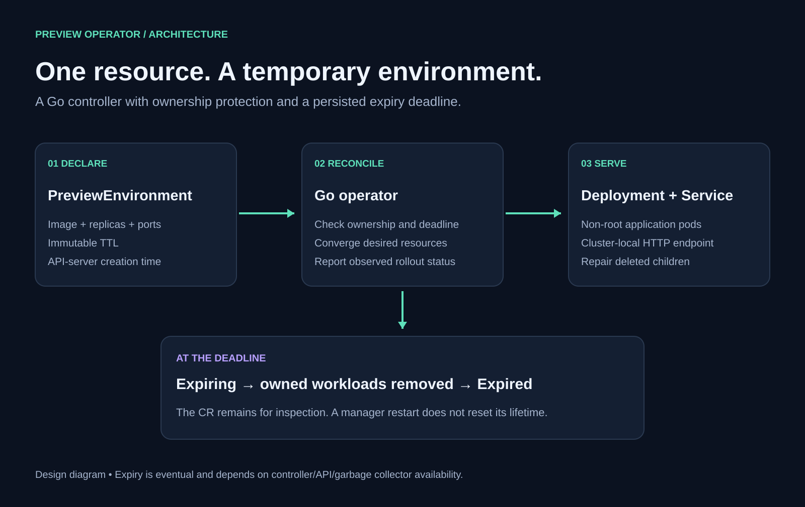

# Preview Operator

A Go Kubernetes operator for temporary application environments. Create one
`PreviewEnvironment` and get a Deployment plus a ClusterIP Service. The operator
repairs deleted children, tracks rollout readiness, and removes the workload at a
persisted deadline, including when that deadline passes while the operator is offline.

**Status:** initial `v1alpha1` implementation. Designed for one trusted team's
namespace; not a tenant-isolation platform. See [verification evidence](docs/verification/README.md)
for what was actually exercised and [operational limitations](docs/OPERATIONS.md#limitations).



## Features

- Immutable lifetime of 60 seconds to seven days, measured from API creation time.
- Image, arguments, ports, resource requests/limits, and zero to ten replicas.
- Owner references, UID-scoped selectors and refusal to adopt foreign resources.
- Optimistic concurrency on updates and UID preconditions on expiry deletion.
- Deployment/Service drift repair and rollout-aware Ready/Expired conditions.
- Foreground expiry cleanup; expired CRs remain as audit records.
- Namespace-scoped cache and RBAC, leader election, structured logs and Events.
- Non-root workloads, read-only root filesystems, disabled application API tokens,
  dropped capabilities, resource budgets and TCP readiness probes.
- Loopback-bound Prometheus metrics, health/readiness probes and repeatable tests.

## Run the complete acceptance test

Prerequisites: Go 1.26+ (verified with 1.27.1), Python 3.9+, Docker, kubectl 1.37, kind
0.33.0, and internet access for the initial dependency/image downloads. Kubernetes
1.37 is the verified version. Run commands from the repository root.

```bash
make verify
make envtest test-integration
make test-e2e
```

The end-to-end runner builds the image, creates a dedicated kind cluster with a
separate kubeconfig, runs live HTTP/lifecycle/security checks, saves evidence in
`docs/verification/`, and removes its cluster. It refuses to reuse an existing
cluster of the same name. Set `KEEP_CLUSTER=1` to inspect it after a run, or
`E2E_CLUSTER=another-test-name` to use a different name. Set `KUBECTL=/path/to/kubectl`
to select a matching client version. Docker images/build caches
are retained for fast subsequent builds.

## Interactive local demo

Use a new cluster name; the kubeconfig below is separate from your normal context.

```bash
mkdir -p .cache
export KUBECONFIG="$PWD/.cache/demo.kubeconfig"
kind create cluster --name preview-operator-demo \
  --image kindest/node:v1.37.0 --kubeconfig "$KUBECONFIG"
make docker-build
kind load docker-image preview-operator:dev --name preview-operator-demo
kubectl apply -k config/default
kubectl wait --for=condition=Established \
  crd/previewenvironments.preview.garv.dev --timeout=60s
kubectl rollout status deployment/preview-operator -n preview-system
kubectl apply -f config/samples/preview.yaml
kubectl wait --for=condition=Ready preview/hello-preview \
  -n preview-system --timeout=120s
kubectl get preview,deploy,svc,pods -n preview-system
kubectl port-forward -n preview-system service/hello-preview 8088:80
```

In a second terminal:

```bash
curl http://localhost:8088
# Hello from preview-operator
```

Stop port-forward with Ctrl-C. Delete a managed Deployment and watch it return:

```bash
kubectl delete deployment/hello-preview -n preview-system
kubectl get preview,deploy,pods -n preview-system --watch
```

Use a **new** CR with `ttlSeconds: 60` to observe expiry. TTL cannot be changed on
an existing CR. At expiry, status moves through `Expiring` to `Expired`; the CR
stays available for inspection. Delete and recreate the CR for a new lifetime.

Cleanup after the interactive demo:

```bash
kind delete cluster --name preview-operator-demo
unset KUBECONFIG
```

## API example

```yaml
apiVersion: preview.garv.dev/v1alpha1
kind: PreviewEnvironment
metadata:
  name: hello-preview
  namespace: preview-system
spec:
  image: hashicorp/http-echo:1.0.0
  args: ["-text=Hello from preview-operator", "-listen=:8080"]
  replicas: 1
  containerPort: 8080
  servicePort: 80
  ttlSeconds: 3600
```

| Field | Default | Contract |
| --- | --- | --- |
| `image` | required | OCI reference; use immutable digests outside local demos |
| `args` | image defaults | Maximum 32 arguments; no shell interpolation by the operator |
| `replicas` | `1` | `0..10`; zero pauses the application without extending expiry |
| `containerPort` | `8080` | `1024..65535`, TCP; application must listen on this port |
| `servicePort` | `80` | `1..65535`, ClusterIP only |
| `ttlSeconds` | `3600` | `60..604800`, immutable |
| `resources` | see below | Kubernetes resource requests/limits; admission validates child objects |

With no requests or limits supplied, each container requests 50m CPU / 32Mi memory
and is limited to 250m CPU / 128Mi memory. When customizing resources, provide a
complete budget: missing entries are not automatically merged with these defaults.
Containers run as UID/GID 10001 and may write only to the 64Mi `/tmp` volume.
Choose a compatible image. The sample is an HTTP application; readiness verifies
TCP connectivity, not business-level health.

Status includes `phase`, `observedGeneration`, `availableReplicas`, `expiresAt`,
`endpoint`, and `Ready` / `Expired` conditions. The endpoint is cluster-local and
is published only for a completed, available rollout. See [architecture](docs/ARCHITECTURE.md)
for the lifecycle and failure semantics.

## Repository map

```text
api/v1alpha1/          API types, generated deepcopy, API tests
cmd/manager/          process entry point, probes, leader election
internal/controller/ reconciliation, desired resources, unit tests
config/               generated CRD, RBAC, kustomize deployment, sample
test/integration/     real API-server admission and reconciliation tests
hack/                 isolated kind acceptance test and evidence rendering
docs/                 plan, architecture, runbook, measured verification
output-images/        all generated diagrams and final output images
```

Build a versioned binary with `make build VERSION=v0.1.0`. The module path is
`github.com/Garvity/preview-operator`; the local project does not require a published
GitHub repository to build. Image publication and deployment to a shared cluster
are separate operator actions; see the [runbook](docs/OPERATIONS.md).

Read the [implementation plan](docs/IMPLEMENTATION_PLAN.md),
[contribution guide](CONTRIBUTING.md), and [security model](SECURITY.md).

Licensed under Apache-2.0.
