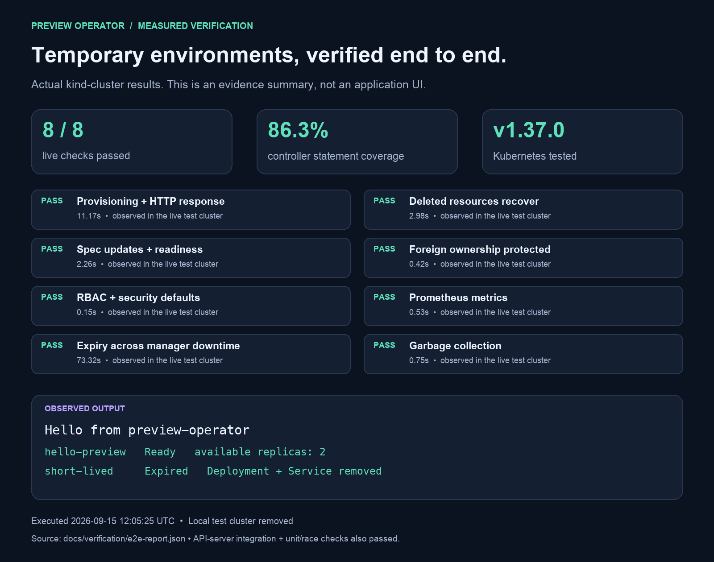

# Verification evidence

The files in this directory record actual local execution. The end-to-end runner
creates an isolated kind cluster and its own kubeconfig, exercises the operator,
and deletes that cluster. The operator's Git commit timestamps were explicitly
assigned at the user's request; test timestamps are the actual execution times.

## Results

- Unit tests and race detector: passed; controller coverage **86.3%**.
- API package coverage including generated deepcopy code: **39.4%**. The hand-written
  deadline and replica-default methods have 100% statement coverage. Total unit-test
  coverage across API and controller packages is **73.4%**; this is not whole-manager
  coverage and does not include integration/end-to-end coverage instrumentation.
- `go vet`, manager build, kustomize rendering, generated-file drift check: passed.
- Real API-server integration: passed on Kubernetes 1.37.
- Live kind acceptance suite: eight checks passed; see `e2e-report.json` for timings.

| Live check | What the test actually asserts |
| --- | --- |
| Provisioning and HTTP | Real pods become Ready and the service returns the configured message |
| Child deletion recovery | Deleting both children creates a new Deployment UID and a working Service |
| Spec updates | Scaling to two replicas updates observed generation and availability |
| Ownership conflict | A foreign Service remains untouched; no partial Deployment is created |
| RBAC and defaults | Manager cannot get Secrets or out-of-namespace Deployments; pod restrictions are present |
| Metrics | Live Prometheus endpoint exposes controller and lifecycle metrics |
| Restart and expiry | Manager is absent across the deadline; on return it removes children and does not resurrect them after a spec edit |
| Garbage collection | Deleting the owner removes its Deployment, Service and labeled Pods |

API-server integration checks eight invalid schema inputs, server defaults,
immutable TTL, idempotency under API defaulting, rollout generations, preservation
of allocated Service IPs, Service repair and initiation of foreground cleanup.
Because envtest has no Deployment controller or garbage collector, its rollout
status is explicitly simulated and its expiry assertion stops at `Expiring`.
The kind tests supply the real workload/deletion evidence.

## Files

- `summary.json`: unit/build/static-check summary and tool versions.
- `coverage-summary.txt`: actual output from `go tool cover -func=coverage.out`.
- `integration-tests.log`: real API-server integration test output.
- `e2e-report.json`: machine-readable outcome, timings, observed CR snapshots and timestamps.
- `e2e-run.log`: build, cluster setup and acceptance-test transcript.
- `e2e-resources.txt`: actual resource listing before test cleanup.
- `e2e-metrics.txt`: metrics captured from the running manager.



The images are diagrams and visual summaries of these results, not screenshots
of a GUI. All SVG/PNG output is stored under `output-images/`.

## Reproduce

```bash
make verify
go tool cover -func=coverage.out
make envtest test-integration
# The downloaded envtest bundle includes a matching kubectl:
KUBECTL="$(./bin/setup-envtest use 1.37.0 --bin-dir "$PWD/.envtest" -p path)/kubectl" make test-e2e
python3 hack/render_evidence.py  # optional; requires Pillow
```

The render script reads existing evidence; it does not execute tests or recalculate
coverage. Rebuild `summary.json` from current unit/build results before using it
to represent a changed implementation. `make test-e2e` overwrites the current run's
evidence, so inspect `status` and `finishedAt` before relying on an older image.

Initial development encountered a Docker multi-platform archive import issue and
mixed kubectl warning/JSON output in the harness; both were corrected before the
passing acceptance run. The final run uses the matching Kubernetes 1.37 client.
No remote GitHub Actions run, load test, cloud HA test or independent security
audit is claimed. The scope and operational limits are documented in the runbook.
